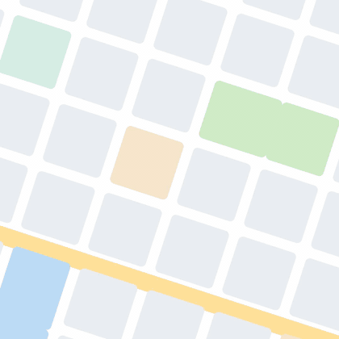
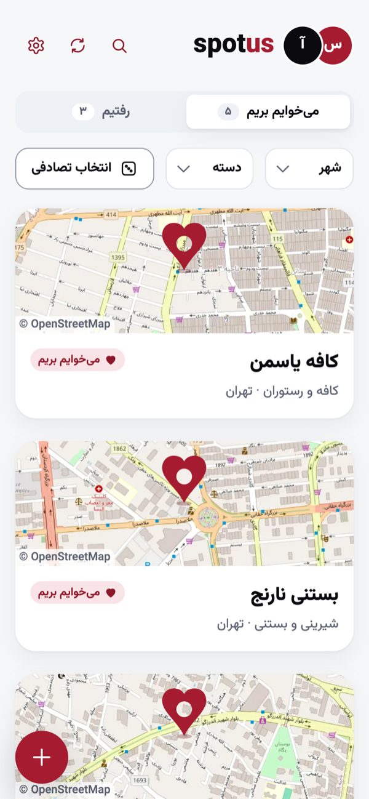
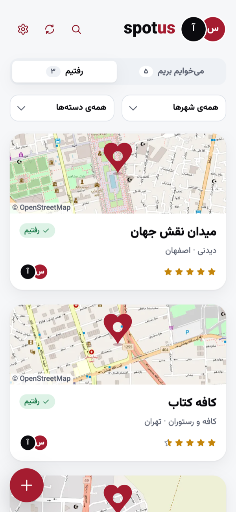
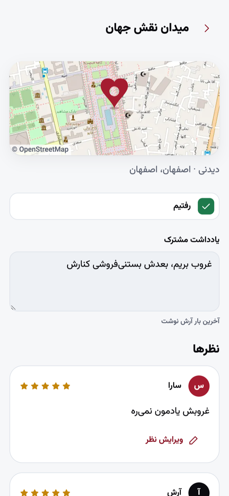
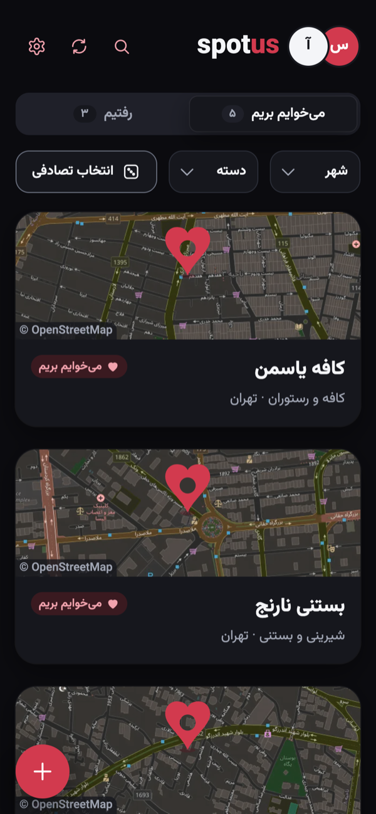

  کد منبع این پروژه تو ریپازیتوری خصوصی <a href="https://github.com/Mahdi-Alz/spot-us">spot-us</a> نگهداری می‌شه و این ریپازیتوری فقط برای معرفی اونه. اگه دوست داری کد رو ببینی یا درباره‌اش حرف بزنیم، از طریق پروفایل گیت‌هاب بهم پیام بده.

  

<h1 align="center">اسپات‌آس · SpotUs</h1>

  فهرست مشترک جاهایی که دوتایی می‌خوایم بریم

  <a href="https://app.spotus.ir">اپلیکیشن</a> ·
  <a href="https://spotus.ir">صفحه معرفی</a>

  

  
  
  
  

## این پروژه چیه؟

اسپات‌آس یه وب‌اپ فارسی برای زوج‌هاست. هر کدوم جایی که می‌خواد بره (کافه، پارک، موزه، اتاق فرار...) رو به یه فهرست مشترک اضافه می‌کنه، شریکش همون لحظه می‌بینه، و بعد از رفتن هر دو نفر امتیاز و نظر خودشون رو می‌نویسن.

اپ برای موبایل ساخته شده و مثل یه برنامه نصب می‌شه (PWA).

نسخه آنلاین: [app.spotus.ir](https://app.spotus.ir)

## امکانات

- **فهرست مشترک**: «می‌خوایم بریم» و «رفتیم»، با فیلتر شهر و دسته، جست‌وجو و دکمه «انتخاب تصادفی» برای وقتی نمی‌تونیم تصمیم بگیریم
- **اتصال به شریک**: دعوت با کد یک‌بارمصرف، لینک یا QR، و پیوستن در یک تراکنش
- **همگام‌سازی و اعلان**: صفحه شریک با تغییرها به‌روز می‌شه و اعلان Web Push می‌رسه (جای جدید، رفتیم، حذف)
- **نظر هر نفر جدا**: هر کدوم ستاره و نظر خودش رو داره، به‌علاوه یه یادداشت مشترک برای هر مکان
- **افزودن از پست اینستاگرام**: لینک پست رو می‌ذاری، اسم، دسته، شهر و آیدی مکان با هوش مصنوعی از کپشن درمیاد
- **پیدا کردن روی نقشه**: جست‌وجو در نشان و پیش‌نمایش نقشه با داده OpenStreetMap
- **جدا شدن بی‌دردسر**: هر نفر می‌تونه تنها بره؛ هر کدوم جداگانه انتخاب می‌کنن جاها رو نگه دارن یا پاک کنن، با مهلت ۳۰ روزه
- **ورود با ایمیل یا موبایل**: کد فقط برای ثبت‌نام و فراموشی رمز، بعدش ورود با رمز عبور
- **آفلاین**: آخرین فهرست بدون اینترنت هم دیده می‌شه
- **پنل مدیریت** فقط‌خواندنی با آمار کاربران و ثبت‌نام‌ها

## Tech stack

| Area | Choice |
| --- | --- |
| Frontend | Nuxt 4 (Vue 3) in JavaScript, Pinia, VueUse, Tailwind CSS v4 |
| Backend | Nuxt server routes (Nitro) on Vercel |
| Database | PostgreSQL on Neon, Drizzle ORM |
| Auth | Better Auth, email codes via Resend and SMS codes |
| Notifications | Web Push (VAPID), service worker via `@vite-pwa/nuxt` |
| AI | Language model that reads Instagram captions, with a fallback provider |
| Maps | Neshan for search, OpenStreetMap for previews |

## سازنده

مهدی علیزاده · [Mahdi-Alz](https://github.com/Mahdi-Alz)

